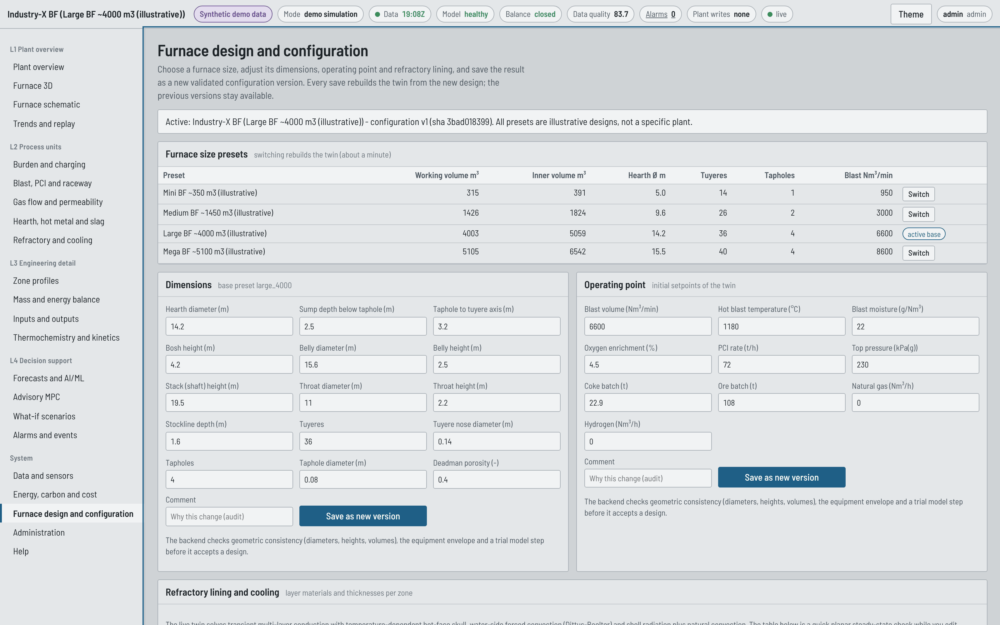
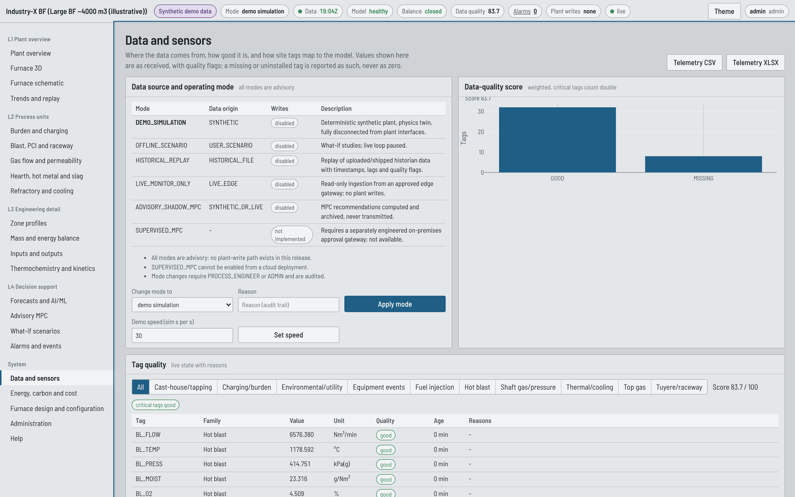
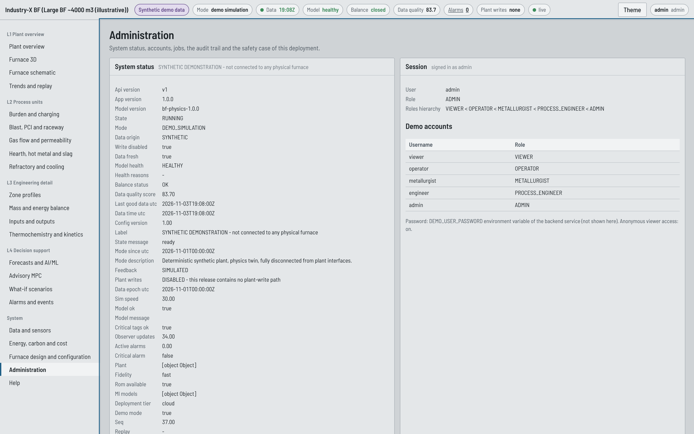

# Administration guide

For the person who runs the backend: accounts, configuration, data, models and monitoring.
Deployment itself is in [BLAST_FURNACE_DEPLOYMENT_GUIDE.md](BLAST_FURNACE_DEPLOYMENT_GUIDE.md).

## 1. Environment variables

| Variable | Default | Meaning |
|---|---|---|
| `APP_ENV` | development | `production` on Render |
| `DEMO_MODE` | true | demo accounts and synthetic plant; `false` requires `JWT_SECRET` >= 32 characters |
| `DEMO_USER_PASSWORD` | - | password of the five demo accounts (>= 10 characters, otherwise no accounts are created) |
| `JWT_SECRET` | random per start | token signing key; set it, or tokens become invalid on every restart |
| `JWT_EXPIRE_MIN` | 480 | token lifetime |
| `ALLOW_ANONYMOUS_VIEWER` | true | read-only access without signing in |
| `CORS_ORIGINS` | http://localhost:5173 | comma-separated frontend origins, exact match |
| `DATABASE_URL` | SQLite under `DATA_DIR` | `postgresql://...` for persistence |
| `DATA_DIR` | ./data | SQLite file and the model registry (`data/models`) |
| `PLANT_PRESET` | large_4000 | preset used when no configuration exists yet (`mini_350`, `medium_1500`, `large_4000`, `mega_5000`) |
| `SIM_SPEED` | 30 | simulated seconds per wall-clock second in demo mode |
| `SIM_AUTOSTART` | true | start the twin loop at start-up |
| `WORKER_THREADS` | 2 | background job threads (1 on small instances) |
| `RATE_LIMIT_PER_MIN` | 600 | requests per minute per client IP |
| `MAX_UPLOAD_MB` | 10 | historian upload limit |
| `RAW_SAMPLE_RETENTION_DAYS` | 7 | stored raw samples older than this (data time) are pruned |
| `NMPC_TIME_BUDGET_S` | 45 | wall-clock budget of a nonlinear MPC job |
| `JOB_TIMEOUT_S` | 1800 | a background job running longer ends FAILED (checked at every progress report) |
| `JOB_QUEUE_TIMEOUT_S` | 900 | a job that waited longer than this before starting ends FAILED |
| `JOB_MAX_PENDING` | 16 | queued-job cap; further submissions get 503 `QUEUE_FULL` |
| `JOB_KEEP_IN_MEMORY` | 200 | finished jobs kept in memory; older jobs and results are served from the database |
| `EDGE_INGEST_TOKEN` | empty | enables `/api/v1/data/ingest` for a read-only edge collector |
| `DEPLOYMENT_TIER` | cloud | `cloud` or `onprem` (informational; supervised modes are refused) |
| `ALLOW_PLANT_WRITES` | false | must stay false; `true` stops the service at start-up |
| `LOG_LEVEL` | INFO | JSON logs to stdout |

## 2. Accounts and roles

Demo accounts `viewer`, `operator`, `metallurgist`, `engineer`, `admin` share
`DEMO_USER_PASSWORD`. Roles are hierarchical (VIEWER < OPERATOR < METALLURGIST < PROCESS_ENGINEER
< ADMIN); the minimum role of every endpoint is listed in [API_REFERENCE.md](API_REFERENCE.md).
For production use, put the backend behind the site's identity provider and disable demo mode.

## 3. Furnace configuration

*Furnace design and configuration* (PROCESS_ENGINEER):

- **Presets**: four illustrative furnace sizes. Switching rebuilds the twin; the shipped warm
  state loads in seconds when the physics sections match.
- **Dimensions** and **operating point**: edit and save as a new version.
- **Refractory lining**: per zone, choose materials and thicknesses; a planar steady-state check
  shows the expected heat flux before you save.
- **Full JSON**: every section (materials and chemistry, coke and PCI quality, kinetics
  calibration, tapping practice, targets, constraints, equipment limits, rate limits, economics,
  carbon factors).

Every save is validated (JSON schema, engineering checks, a trial model step), stored as a new
version with author and comment, and uses optimistic concurrency (`expected_version`; a stale
save gets 409). Targets, limits, prices and labels do not change the physics hash, so editing
them keeps the shipped initial state and identified ROM valid.

**Roll-back.** Stored versions are never changed. To return to an earlier design, press *Load* on
that row of *Configuration versions* (or `GET /api/v1/config/plant/versions/{version}`), review it
in the JSON editor and save it: it becomes a new version with your comment. Download the active
configuration before any significant change.

## 4. Data and sensors

- **Mode**: DEMO_SIMULATION, HISTORICAL_REPLAY (after an upload), LIVE_MONITOR_ONLY (edge push),
  ADVISORY_SHADOW_MPC. Mode changes need a reason and are audited.
- **Tag mapping**: download the template, fill site tag names and units, map them here or post
  to `/api/v1/tags/map`. Uninstalled tags show as UNAVAILABLE.
- **Uploads**: CSV, CSV.GZ or XLSX; timestamps first; formula-like cells and macro workbooks are
  rejected; the parse report lists mapped, unmapped and missing tags.
- **Demo fault injection**: drift, bias, stuck, dropout or disorder on any synthetic tag, to show
  the quality engine, the observer and the trust gate at work.

## 5. Models

- **Prediction model (ROM)** for the MPC: *Advisory MPC > Re-identify on the current state*
  (about a minute of step tests on twin clones). Re-identify after a preset or major
  configuration change.
- **Forecast models**: *Forecasts and AI/ML > Retrain on shipped history* or
  `POST /api/v1/models/train`. Every model is registered under `DATA_DIR/models` with its dataset
  hash, seed, package versions and metrics; demo models are never approved for plant use. A model
  is promoted to the primary forecast only if it beats the baselines by 2 % on the test block.
- **Regenerating shipped artefacts** (initial states, ROM, 12-day history, models):
  `python scripts/seed_demo.py --all` (about 30 minutes on one CPU).
- **Artefact integrity**: snapshots (`data/demo/*.pkl.gz`) and models (`model.joblib`) are pickles. The service
  deserialises one only if its SHA-256 matches the sidecar (`file_sha256` / `artifact_sha256`), written when the
  artefact is created. Never copy artefacts from an untrusted source into `DATA_DIR`.
- **Documentation figures and example data**: `python scripts/make_doc_figures.py`.

## 6. Monitoring

| Endpoint | Use |
|---|---|
| `/health` | liveness (Render health check) |
| `/ready` | twin initialised and database reachable |
| `/metrics` | Prometheus text: `bf_twin_ready`, `bf_data_fresh`, `bf_data_quality_score`, `bf_balance_ok`, `bf_active_alarms`, `bf_stream_seq`, `bf_jobs{status}`, `bf_persistence_errors_total{record}` (database writes that failed - the twin keeps running, the failure is counted and logged), `bf_plant_writes_enabled` (always 0) |
| `/api/v1/system/status` | everything the status strip shows |
| `/api/v1/system/audit` | audit trail (ADMIN) |
| `/api/v1/system/jobs` | background jobs |

Logs are JSON lines on stdout with a request id; Render shows them under *Logs*.

## 7. Backups and retention

SQLite on the Render free plan is lost on restart. With Postgres, use the provider's backups.
Data held: users and roles, configuration versions, alarms, recommendations and decisions,
audit events, forecast runs, observer snapshots, model versions, raw telemetry samples (one every
five twin steps, pruned after `RAW_SAMPLE_RETENTION_DAYS`).
Uploaded files are parsed in memory and not stored.

## 8. Database migrations

The schema is created at start-up; Alembic migrations are in `alembic/versions`
(`alembic upgrade head` with `DATABASE_URL` set) for managed Postgres deployments.
