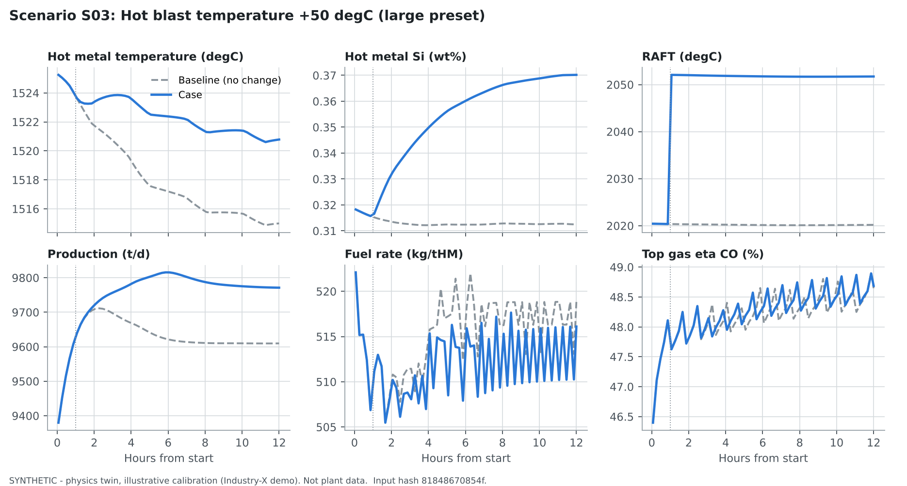
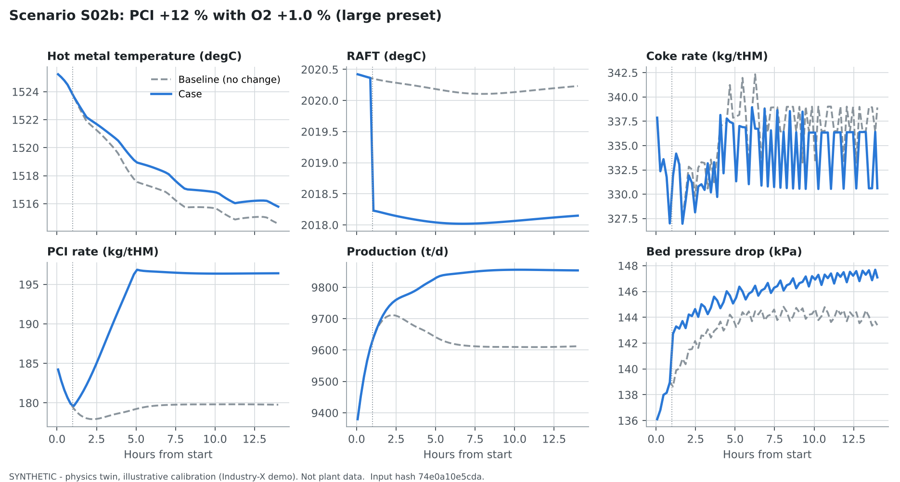
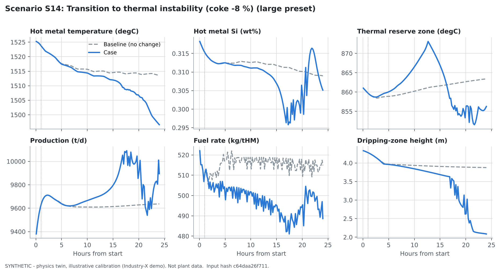

# Model validation

> Everything below was produced on **synthetic** data: the "plant" is a second instance of the
> physics model with different true parameters, sensor noise, lags, lab delays and injected
> faults. It demonstrates that the software is internally consistent and behaves as designed.
> It does **not** validate the model against a real blast furnace. Plant validation is stages
> G1-G3 of [COMMISSIONING_PLAN.md](COMMISSIONING_PLAN.md), summarised at the end of this document.

## 1. Verification (does the code do what the equations say?)

| Property | Evidence | Result |
|---|---|---|
| Every reaction conserves every element | `test_stoichiometry.py` (all 45 reactions and compiled transfers) | pass |
| Per-step element and energy balance closes | `test_conservation.py::test_every_step_closes_elements_and_energy` (relative element residual < 1e-9, energy < 1e-6) | pass |
| Cumulative balance over many hours closes | `test_cumulative_balance_closes` | pass |
| Inventories never negative | `test_inventories_stay_non_negative` | pass |
| Hearth casting conserves metal, slag and enthalpy | `test_hearth_tapping_conservation` | pass |
| Thermodynamic functions behave correctly | `test_thermodynamics.py` (enthalpy monotonic, Boudouard shifts to CO at high T, Baur-Glaessner Fe/FeO boundary, C saturation range, slag viscosity falls with T, sulfide capacity rises with basicity) | pass |
| Unit conversions | `test_units.py` (temperature, energy, gauge pressure, Nm3, incompatible units refused) | pass |
| Numerical stability | `test_long_horizon_numerical_stability` (multi-day run, bounded states) | pass |

The live service publishes the element and energy residual of every step (`Balance` chip in the
status strip, Mass and energy balance page). In the shipped demo run the maximum relative
element residual is round-off level (about 1e-12 to 1e-15).

## 2. Physical plausibility (do responses have the right sign and size?)

Directional tests from the warm-started large preset (`test_dynamics.py`, `test_limiting_cases.py`):

| Change | Expected (plant experience) | Test |
|---|---|---|
| Hot blast temperature up | lower zone and RAFT hotter | pass |
| Blast moisture up | lower zone cooler (water-gas reaction in the raceway) | pass |
| Oxygen enrichment up | RAFT and production up | pass |
| Blast volume up | bed pressure drop up | pass |
| Burden change at the top | arrives at the cohesive zone after the descent time | pass |
| Zero PCI, zero enrichment, metallic HBI burden, dry/wet top gas | limiting cases consistent | pass |
| Constant inputs | production and fuel rate stay within a band (steady-state consistency) | pass |

Quasi-steady states of the four illustrative presets (after the shipped warm start):

| Quantity | Unit | Mini ~350 m3 | Medium ~1450 m3 | Large ~4000 m3 | Mega ~5100 m3 |
|---|---|---|---|---|---|
| Working volume | m3 | 315 | 1,426 | 4,003 | 5,105 |
| Production | t/d | 1,085 | 3,993 | 9,353 | 13,343 |
| Productivity | t/m3/d | 3.44 | 2.80 | 2.34 | 2.61 |
| Hot metal temperature | degC | 1,494 | 1,494 | 1,525 | 1,501 |
| Hot metal Si / C / S | wt% | 0.57 / 4.69 / 0.027 | 0.43 / 4.72 / 0.025 | 0.32 / 4.83 / 0.019 | 0.46 / 4.71 / 0.022 |
| Coke / PCI / fuel rate | kg/tHM | 491 / 89 / 579 | 380 / 144 / 525 | 338 / 185 / 523 | 319 / 165 / 484 |
| Slag rate, B2 | kg/tHM, - | 313, 1.24 | 311, 1.19 | 311, 1.23 | 305, 1.28 |
| RAFT | degC | 2,094 | 2,070 | 2,020 | 2,083 |
| Top gas eta CO | % | 40.1 | 47.2 | 46.7 | 50.9 |
| Bed pressure drop | kPa | 115 | 112 | 137 | 171 |
| Wall + cooling heat loss | MW | 7.9 | 18.3 | 35.2 | 37.4 |
| Solution loss | kgC/tHM | 89 | 82 | 76 | 75 |

These sit inside published operating ranges for furnaces of these sizes (e.g. Geerdes et al.,
*Modern Blast Furnace Ironmaking*). The table is regenerated by `scripts/make_doc_figures.py`
(`docs/figures/preset_state_table.md`, `data/examples/preset_state_table.csv`).

The model is not perfectly steady at constant inputs: the layered burden, the cohesive zone and
the casting cycle produce slow oscillations of a few percent in production and about 10 degC in
HMT over tens of hours. This is why every what-if case is compared with a baseline run from the
same state with the same numerics.

## 3. Scenario results (large preset, physics twin, SYNTHETIC)

**S03 hot blast +50 degC** (12 h): HMT +5.8 degC, Si +0.06 wt%, RAFT +32 degC, production +160 t/d,
fuel -2.7 kg/tHM. RAFT responds within a step (about +0.63 degC per degC of blast), HMT and Si with
the thermal inertia of the lower zone and hearth.

**S02b PCI +12 % with O2 +1 %** (14 h): RAFT -2 degC (oxygen compensates the injectant's cooling),
production +240 t/d, coke rate -8.3 kg/tHM against PCI +16.6 kg/tHM, so fuel rate +8 kg/tHM and an
apparent replacement ratio of about 0.5 at 14 h. Plants report 0.8-0.9 at steady state; the gap is
a known limitation of the short horizon and of the illustrative calibration (see LIMITATIONS.md).

**S14 coke -8 %** (24 h): HMT -17 degC and falling, dripping-zone height collapsing from 3.6 to
2.1 m, erratic production as the cohesive zone descends. This scenario deliberately leaves the
validated envelope; its late-time detail (for example the Si spike near 22 h) is **not**
reliable and is shown only to illustrate how the twin signals a thermal-instability path.

Trajectories of every KPI for these runs are in `data/examples/scenario_*_trajectories.csv`
(input hash and model version in the header).

## 4. Observer (state and parameter estimation)

- `test_observer.py`: the HMT bias state converges; a single outlier is gated; a lab value that
  arrives late is applied at its sampling time; reconciliation closes the N/C/O balance and
  flags an injected gross error.
- 12-day synthetic history with four injected instrument faults (CO2 analyser drift at 60 h,
  stuck sump thermocouple at 110 h, top-pressure dropout at 170 h, blast-temperature bias at
  230 h): the quality engine flags each fault, the observer rejects the faulty channel and the
  trust gate suppresses advice while a critical tag is not GOOD; parameters return toward the
  calibration after the faults clear (mean-reversion time constant 72 h).

## 5. Forecast models (hybrid ML)

Trained on the shipped 12-day synthetic history (chronological train / validation / test with an
embargo; HistGradientBoosting residual; seed 42). Test-block RMSE:

| Model | Test n | Hybrid | Physics + observer | Persistence | ARX ridge | 95 % coverage | Promoted |
|---|---|---|---|---|---|---|---|
| HMT 1 h | 1687 | 5.10 degC | **5.06** | 6.68 | 24.4 | 0.96 | no |
| HMT 2 h | 1681 | 5.15 | 5.17 | 6.76 | 10.5 | 0.99 | no (within 2 %) |
| HMT 4 h | 1670 | 5.68 | **5.64** | 7.30 | 8.19 | 0.97 | no |
| Si 2 h | 593 | 0.039 wt% | 0.039 | **0.038** | 0.147 | 0.80 | no |

Reading:

- The physics twin with the observer beats persistence by about 25 % for HMT at 1-4 h.
- The ML residual adds nothing measurable on this data (validation-chosen shrinkage 0.1-0.5 for
  HMT, 0 for Si). No model meets the promotion rule (test RMSE at least 2 % below the best
  baseline), so the desk shows physics + observer as the forecast and the ML value as a shadow.
- Si interval coverage is 0.80 against a nominal 0.95: the test block contains operating points
  outside the training range (drift detected on blast volume, temperature, moisture and
  oxygen). The intervals are therefore not trustworthy for Si on this data.

These numbers say nothing about plant performance: synthetic noise and model mismatch are of
our own making.

## 6. Advisory MPC

`test_mpc.py`: identified gains have physical signs; feasible problems improve the objective;
MV bounds and rate limits are honoured (including the last block); an unavailable MV is never
moved; an infeasible hard limit returns NO_FEASIBLE_SOLUTION with no action; the trust gate
suppresses advice; the physics verifier runs and checks limits; acknowledging changes audit
state only. `test_api_contract.py` checks the endpoint contract, zone control of Si, and that
advice is advisory-only.

## 7. What plant validation requires (stages G1-G3)

1. At least 3-6 months of historian data with lab results, casting records and charging
   records, mapped with the tag template; a data-quality review.
2. Calibration of the provisional kinetic constants, heat-transfer coefficients and burden
   properties to the plant's heat and mass balance (shift and monthly balances).
3. Hindcast on held-out months: HMT and Si forecast error against persistence and against the
   plant's existing thermal indicators; top gas, dP and stave heat loads.
4. Re-identification of the ROM on the calibrated twin, plus step tests reviewed by the plant's
   process engineers before any advisory use.
5. Retraining and re-validation of ML models on plant data; only models that beat the
   baselines are promoted, and all remain labelled not approved for control.
6. Live read-only shadow operation (G2), then operator-advisory use with logged decisions (G3).
7. Formal acceptance by the plant against site-agreed thresholds, with the sign-offs listed in
   [COMMISSIONING_PLAN.md](COMMISSIONING_PLAN.md).
