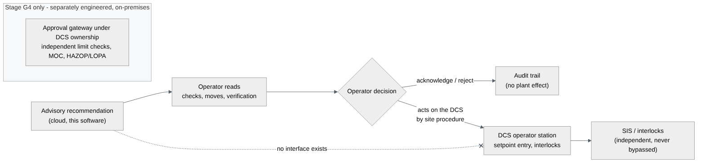

# Advisory MPC specification

> **Advisory only.** This release computes recommendations for an operator to read. It has no
> interface to the DCS, PLC or SIS, sends nothing, and cannot be configured to send anything
> (`ALLOW_PLANT_WRITES=true` stops the service). Acknowledging a recommendation writes an audit
> record and nothing else. Any setpoint change is made by the operator on the DCS under site
> procedures, interlocks and the SIS, which this software never bypasses.

## 1. Purpose and scope

Thermal-state control of the blast furnace on a horizon of hours: keep hot metal temperature
(HMT) near its target, keep hot-metal Si inside its window, respect RAFT, bed pressure drop and
top gas limits, with the smallest and cheapest moves.

## 2. Variables

Manipulated variables (MV) - equipment envelope from `equipment_limits`, rate limits per 15 min
from `rate_limits_per_15min` in the plant configuration:

| MV | Unit | Default availability | Identification step |
|---|---|---|---|
| Hot blast temperature `blast_temp_C` | degC | on | +/-25 |
| Blast moisture `blast_moisture_g_Nm3` | g/Nm3 | on | +/-4 |
| Oxygen enrichment `o2_enrichment_pct` | % | on | +/-0.75 |
| PCI rate `pci_t_h` | t/h | on | +/-6 % of operating point (min 0.5) |
| Blast volume `blast_volume_Nm3_min` | Nm3/min | on | +/-3 % |
| Coke batch `coke_batch_t` | t | **off** (opt-in) | +/-2 %, limited by the ore/coke ratio window |

The coke lever is opt-in because its identified short-horizon gain on HMT is weak in this
model (see [LIMITATIONS.md](LIMITATIONS.md)). An operator can lock any MV (unavailable valve,
maintenance) for a request.

Controlled variables (CV) and default weights (normalised by engineering scale):

| CV | Scale | Weight | Default target |
|---|---|---|---|
| HMT `hmt_C` | 15 degC | 1.0 | midpoint of the configured HMT window |
| Si `hm_si_pct` | 0.08 wt% | 0.6 | **zone**: hold the current value inside its window, nearest edge outside |
| RAFT `raft_C` | - | 0.05 | free response (soft limits apply) |
| Fuel rate `fuel_rate_kg_tHM` | 10 kg/tHM | 0.15 | hold current (cost belongs in the economic term) |
| dP, top gas T, eta CO, production | - | 0 | constraint / information only |

Si is zone-controlled because Si and HMT respond almost collinearly to every lever: two
conflicting setpoints would make the optimiser exploit tiny differences in gain ratios with large
opposing moves. Users can still enter an explicit Si setpoint.

## 3. Prediction model

A step-response (DMC) model identified on clones of the physics twin at the current operating
point (`app/mpc/predictions.py`): symmetric +/- steps of each MV, interval-averaged CVs, 3-point
smoothing, sample time 15 min, horizon 12 h (48 samples). An output-disturbance estimate from the
observer makes the prediction offset-free. The identified steady-state gains and t63 times are
shown on the Advisory MPC page; the shipped ROM for the large preset (per unit MV):

| CV \ MV | blast T (per degC) | moisture (per g/Nm3) | O2 (per %) | PCI (per t/h) | blast volume (per Nm3/min) | coke batch (per t) |
|---|---|---|---|---|---|---|
| HMT degC | +0.12 | -0.70 | +7.8 | -0.80 | +0.011 | +1.4 |
| Si wt% | +0.0011 | -0.0069 | +0.073 | -0.0084 | +0.0001 | (weak) |
| RAFT degC | +0.63 | -4.1 | +37.6 | -4.6 | - | - |

Signs match plant experience (hot blast and oxygen heat, moisture and PCI at constant oxygen
cool the raceway); magnitudes are those of the illustrative calibration.

## 4. Optimisation problem (linear MPC)

$$ \min_{\Delta U,\,s}\ \sum_{k=1}^{N} (y_k - r)^\top Q (y_k - r) + \Delta U^\top R\, \Delta U + c_{econ}^\top u_N + \rho_1^\top s + \rho_2\, s^\top s $$

subject to

- prediction y = y_free + G dU (G from the step responses, move blocking),
- equipment envelope u_min <= u_now + C dU <= u_max (**hard**),
- rate limits |dU_b| <= rate x block length (**hard**),
- soft CV limits y_lo - s <= y_k <= y_hi + s, s >= 0, only for limits the configuration marks soft,
- hard CV limits without slack.

Move blocking: 4 blocks starting at samples 0, 2, 4 and 8 (15-min samples; the last block spans 4 samples for
rate limits). All rows are normalised by engineering scales. Solver: OSQP (polished; iteration
status handled with a feasibility check), SciPy SLSQP fallback. If no feasible solution exists the
status is NO_FEASIBLE_SOLUTION and **no action is proposed**.

Economic term: c_econ = coke, PCI, oxygen and blast-energy costs per unit MV from the
configuration prices, weighted by `econ_weight` (0 by default). The Pareto study (S12) sweeps this
weight with the coke price at 1.2x.

**Nonlinear option.** `method: nmpc_physics` runs single shooting on the physics twin with move
blocking and SLSQP inside a wall-clock budget, as a background job.

## 5. Trust gate (advice is suppressed unless every check passes)

| Check | Condition |
|---|---|
| mode permits advice | DEMO_SIMULATION, HISTORICAL_REPLAY, LIVE_MONITOR_ONLY or ADVISORY_SHADOW_MPC |
| data quality | score >= 70 and every critical tag GOOD |
| data fresh | newest data within the freshness window (data clock and wall clock) |
| model balance closed | element and energy residuals below tolerance |
| observer healthy | covariance positive definite, innovations not persistently rejected |
| no critical alarm | none active |
| model in envelope | no integrator guard or envelope violation |

A suppressed request returns ADVICE_SUPPRESSED with the failed checks; the screen says why.

## 6. Independent verification

Every proposed move plan is re-simulated on a fresh clone of the **physics twin** for 6 h
(`app/mpc/verifier.py`): MVs must stay inside the envelope, the element residual must stay
closed, hard CV limits must hold, and the physics trajectory is compared with the ROM
prediction. Failures are listed with the recommendation; the display shows all three
trajectories (free response, ROM-optimised, physics re-simulation).

## 7. Recommendation lifecycle

| Status | Meaning |
|---|---|
| PROPOSED | gate passed, feasible, verified; valid 30 minutes |
| ADVICE_SUPPRESSED | trust gate failed (reasons listed) |
| NO_FEASIBLE_SOLUTION | constraints cannot be met; no action proposed |
| NO_ACTIVE_MV | every MV locked or unavailable |
| STUDY_ONLY | computed for a study (verification skipped), never shown as advice |
| ACKNOWLEDGED / REJECTED | operator decision recorded (audit only) |
| EXPIRED | validity elapsed |

Each recommendation stores targets and their basis, trust-gate checks, solver status and time,
objective before/after, active constraints, moves per block, predicted trajectories, a
plain-language explanation (moves below 5 % of a lever's engineering scale are reported as
"hold"), the HMT uncertainty growth, the verification result and the configuration, model and
ROM versions.

## 8. Roles

| Action | Minimum role |
|---|---|
| view recommendations | VIEWER |
| request, acknowledge or reject | OPERATOR |
| what-if, studies, Pareto | METALLURGIST |
| identify the ROM, change configuration, map tags | PROCESS_ENGINEER |
| audit trail | ADMIN |

## 9. Path to supervised control (not in this release)

Stage G4 in the master plan would need, at minimum: an on-premises approval gateway owned by the
plant's DCS team; independent limit checking in the DCS; management of change; HAZOP and LOPA
of the advisory function; operator training; and a site acceptance test. None of this exists in
this software, and no public-cloud deployment may ever be connected to such a gateway.
