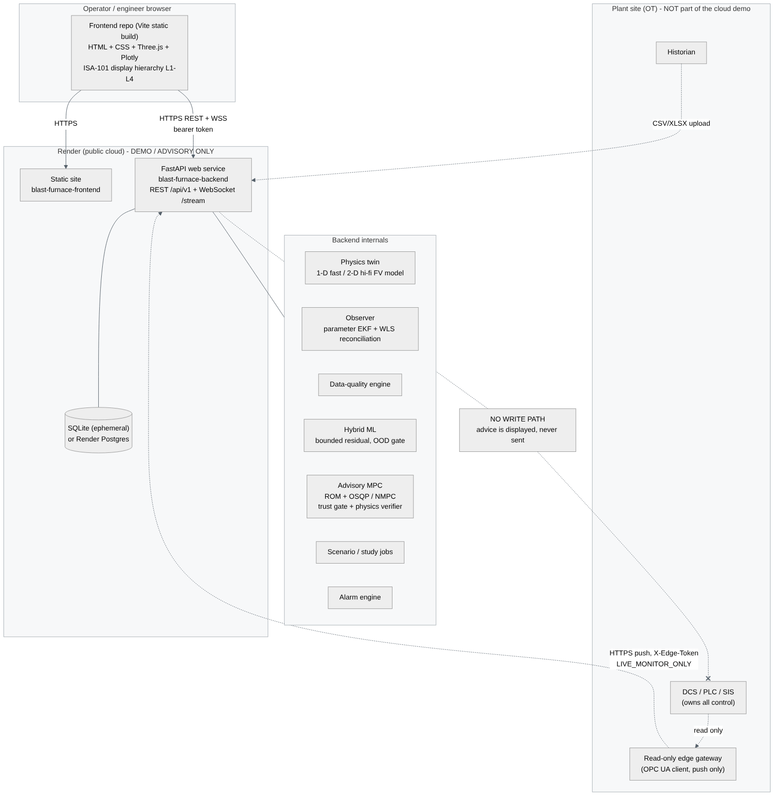
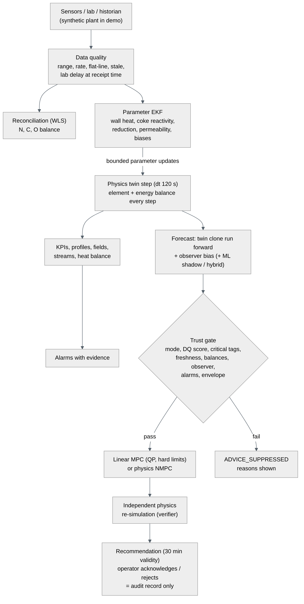

# System architecture



## 1. Components

| Component | Repository | Technology | Runs where |
|---|---|---|---|
| Operator / engineer desk | `blast-furnace-frontend` | Vite static build: HTML, CSS, vanilla ES modules, Three.js (3-D furnace), Plotly (charts) | Render static site (demo) or any web server / CDN |
| API and twin service | `blast-furnace-backend` | Python 3.13, FastAPI, Pydantic v2, SQLAlchemy 2, Alembic, NumPy/SciPy, OSQP, scikit-learn | Render web service (demo) or on-premises container |
| Database | backend | SQLite (default, ephemeral on Render) or PostgreSQL via `DATABASE_URL` | same host / managed Postgres |
| Read-only edge collector (optional) | backend `app/data/opcua_readonly.py` | asyncua OPC UA client | **plant OT / industrial DMZ only**, never on Render |

There is no component that writes to a plant system. The frontend never talks to plant
equipment; it only calls the backend API.

## 2. Process view inside the backend



`app/services/twin_service.py` owns one `TwinService` per process:

1. **Data source** by mode: the synthetic plant (`app/data/synthetic.py`, a second physics model
   with different "true" parameters, sensor noise, lags, lab delays and injectable faults), a
   replayed historian file, or pushed edge readings (`/api/v1/data/ingest`).
2. **Data quality** (`app/data/quality.py`): range, rate of change, flat-line, staleness,
   Hampel outlier, calibration age and lab-sample timing per tag. Raw values are kept; flags and
   reasons are attached. Tags a source cannot provide are UNAVAILABLE with a reason, never zero.
3. **Twin step** (`app/physics/integrator.py`, dt 120 s): the physics model is driven by the
   *measured* manipulated variables and conserves every element and energy each step.
4. **Observer** (`app/estimation/observer.py`): augmented-parameter extended Kalman filter on
   six slow parameters (section 4), plus a WLS N/C/O reconciliation (`reconciliation.py`).
5. **Alarms** (`app/services/alarms.py`): evidence-based detection rules with possible causes.
6. **Forecasts** every 8 steps: the twin is cloned and run forward at the current settings; the
   observer bias is added; a trained ML residual model may run in shadow or, if promoted, as the
   primary forecast (section 5).
7. **Advisory MPC** on request (and as a shadow job): trust gate, QP or NMPC, independent physics
   verification ([MPC_CONTROL_SPECIFICATION.md](MPC_CONTROL_SPECIFICATION.md)).
8. **Persistence** (`app/db`): users, configuration versions, alarms, recommendations, audit
   events, forecast runs, observer snapshots, model versions, telemetry samples.

Long work runs in a bounded thread-pool job manager (`app/services/jobs.py`): 202 response with
a job id, progress, cancel, idempotency keys, and results held in memory (and summarised in the
DB). A Redis/RQ worker tier is **not implemented**; see [LIMITATIONS.md](LIMITATIONS.md).

## 3. Operating modes (`app/core/safety.py`)

| Mode | Data | Purpose |
|---|---|---|
| `DEMO_SIMULATION` (default) | synthetic plant | demonstrations, training |
| `HISTORICAL_REPLAY` | uploaded historian file | offline analysis, model validation |
| `LIVE_MONITOR_ONLY` | edge gateway push | monitoring and advice on real data, still read-only |
| `ADVISORY_SHADOW_MPC` | any | recommendations computed and logged, shown to engineers |
| `SUPERVISED_CONTROL_DISABLED` | - | placeholder state; refused at runtime |

`ALLOW_PLANT_WRITES=true` makes the backend refuse to start. There is no code path that sends a
setpoint anywhere; `tests/test_safety.py` scans the source tree for write calls and imports.

## 4. Observer

State: six slowly varying parameters

| Parameter | Bounds | Measured by |
|---|---|---|
| `wall_heat_mult` (wall heat transfer) | 0.6 - 1.6 | stave/cooling heat load |
| `coke_reactivity_mult` | 0.5 - 2.0 | top gas eta CO |
| `reduction_mult` (ore reducibility) | 0.6 - 1.5 | top gas eta CO, top gas temperature |
| `permeability_mult` | 0.6 - 1.6 | blast pressure - top pressure |
| `hmt_bias_C` | -40 - 40 | HMT dip at casts |
| `si_bias_pct` | -0.4 - 0.4 | Si lab result (at its sampling time) |

- Sensitivities dz/dtheta are computed from the physics twin by finite differences at start-up
  (background, about a minute); until they are ready the filter updates the two bias states only.
- Process noise is small; physical multipliers revert to the configured calibration with an
  Ornstein-Uhlenbeck time constant of 72 h (anti wind-up).
- Covariance update in Joseph form; innovations are gated at 3 sigma; after 10 consecutive
  rejections of a channel its measurement variance is inflated (Huber-type admission) so a real
  shift is eventually learned while single outliers are not.
- Model top gas temperature is lagged (10 min) like the thermocouple; dP is compared as blast
  pressure minus top pressure.
- Parameters are pushed to the twin every 8 steps, inside their bounds.

## 5. Hybrid ML governance

- Physics base = physics twin + observer bias at forecast time; the ML model learns the residual
  to the future measurement, bounded (HMT +/-40 degC, Si +/-0.25 wt%) and shrunk by a factor chosen on
  the validation block.
- Chronological train / validation / test blocks with an embargo gap; split-conformal 95 %
  intervals from the validation block; PCA-subspace Mahalanobis out-of-domain gate.
- Baselines: physics + observer, persistence, ARX ridge. A model is **promoted** to the primary
  forecast only if its test RMSE is at least 2 % below the best baseline; otherwise it runs in
  shadow and the display says so.
- Every model is registered with dataset hash, seed, package versions, metrics and the labels
  `DEMO-SYNTHETIC` / `NOT_APPROVED_FOR_PLANT_USE`.

## 6. Frontend structure

```
src/
  main.js            status strip, navigation rail, hash router, sign-in, theme, stream lifecycle
  lib/api.js         fetch wrapper (bearer token, error envelope), job polling, WebSocket stream with
                     sequence numbers, resync and polling fallback
  lib/ui.js          DOM helpers (no innerHTML for data), faceplates with provenance, tables, formatters
  lib/charts.js      Plotly wrappers, validated categorical palette, small multiples (no dual axes)
  lib/store.js       shared state, status, cached geometry and configuration
  viz/schematic.js   2-D to-scale furnace section (SVG) from the geometry payload with model fields
  viz/furnace3d.js   Three.js cut-away furnace with field section plane, layers, cohesive zone, liquids
  pages/*.js         22 displays in the ISA-101 hierarchy (L1 overview ... L4 decision support, system)
```

Every page module exports `{ title, purpose, mount(root, ctx), onTick?, onEvent?, unmount? }`.

## 7. Interfaces

- REST under `/api/v1` ([API_REFERENCE.md](API_REFERENCE.md)), OpenAPI at `/docs`.
- WebSocket `/api/v1/stream?token=...`: `tick`, `event`, `heartbeat`, `resync` messages with a
  monotonically increasing `seq`; clients that miss messages call `/api/v1/stream/poll?since_seq=`.
  The frontend falls back to polling when WebSockets are blocked.
- Edge ingest `/api/v1/data/ingest` with `X-Edge-Token` (HMAC comparison), only in
  `LIVE_MONITOR_ONLY`; batch timestamps must be UTC.
- Exports: CSV / XLSX / JSON with a provenance header (data origin, configuration and model
  version, UTC time, input hash, units).

## 8. Deployment topologies

| Topology | Use | Notes |
|---|---|---|
| Render (two services from two GitHub repositories) | demonstration, evaluation, training | public cloud, synthetic data only; see the deployment guide |
| On-premises container (Docker) | site pilot in monitor-only mode | historian replay or edge push; behind the site's reverse proxy and SSO |
| Site OT integration | after stage gates G2-G3 | edge collector in the industrial DMZ, read-only; no write path in this release |

See [OT_SECURITY.md](OT_SECURITY.md) for the security architecture.
